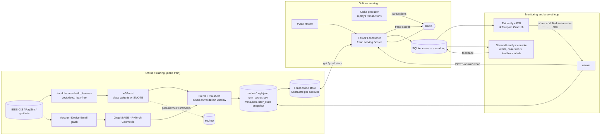

# Architecture

## Design decisions

| Decision | Why |
|---|---|
| One feature definition, two executors (`build_features` vectorised for training, `UserState` incremental for serving) | Removes training/serving skew. `tests/test_features.py::test_training_serving_parity` replays the stream through both and requires equality (<1e-9). |
| Feast stores per-account *state* (running mean, last device/location, last-24h timestamps), not final feature values | Features such as "txn count in the last hour" depend on the incoming transaction's timestamp, so they cannot be pre-materialised. State + shared code gives exact values. |
| Chronological train/val/test split (60/20/20) | A random split lets the model see future behaviour of the same account and overstates results. |
| Graph: accounts - devices/emails; entities linked to >50 accounts removed | Hub nodes (gmail.com, public wifi) connect everybody and drown ring structure. |
| GNN node features are structural + train-window stats only; labels only from the train window | Prevents the GNN from reading test-period content or labels. |
| GNN scores precomputed per account (batch), blended with live XGBoost score | Keeps p99 scoring in single-digit ms. Unseen accounts fall back to the XGBoost score (cold start). |
| Blend weight tuned on validation PR-AUC; threshold = best F1 on validation | Test window is touched once, for reporting. |
| Drift: Evidently report + PSI per feature; `user_txn_count` excluded | That counter increases with time by construction and would always "drift". |
| Retrain trigger closes the loop: drift -> train -> `/admin/reload` | Automatic, no redeploy. |
