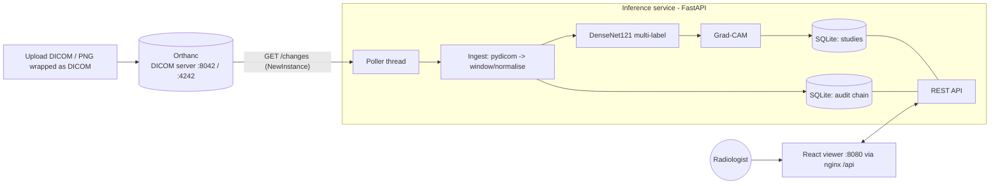

# Architecture

## Data flow
1. A study arrives in Orthanc (C-STORE on 4242 or REST `POST /instances`).
2. The poller follows `/changes`, fetches each `NewInstance`, and calls `ingest()`.
3. `ingest()` parses DICOM, **hashes the patient ID, drops the name**, applies rescale/VOI window/MONOCHROME1 inversion, rejects unsupported modalities (audited as `SKIPPED`), runs the model under a lock, computes Grad-CAM for the top class and stores PNGs + predictions. Ingestion is idempotent (id = hash of SOPInstanceUID).
4. The viewer lists studies, shows image + RGBA heatmap overlay (opacity slider, per-label heatmaps computed on demand), scores, and Approve/Reject.
5. A decision is a conditional UPDATE (`status='pending'`), so a study can be decided once; the full decision context (model version, scores, comment, reviewer) is appended to the audit chain.

## Audit log
`hash = SHA-256(prev_hash | ts | user | action | study_id | canonical_json(details))`. Writers are serialised with `BEGIN IMMEDIATE`; triggers reject UPDATE/DELETE; `GET /audit/verify` recomputes the chain. Limitation: removing the *latest* rows is undetectable unless `GET /audit/head` is anchored externally.

## Design decisions
| Decision | Why |
|---|---|
| Split by patient (hash of patient ID) | Image-level splits leak patients and inflate AUROC |
| No horizontal-flip augmentation | Flips create anatomically implausible images |
| Poll `/changes` instead of Lua callback | Same behaviour without Lua inside the Orthanc container; easy to test |
| SQLite | Single-node demo; swap for Postgres by replacing `db.py`/`audit.py` connections |
| Heatmap as RGBA PNG | Lets the viewer toggle/fade it client-side |
| `UNTRAINED-DEMO` fallback | Whole stack is demoable before training finishes, and never silently pretends to be trained |
